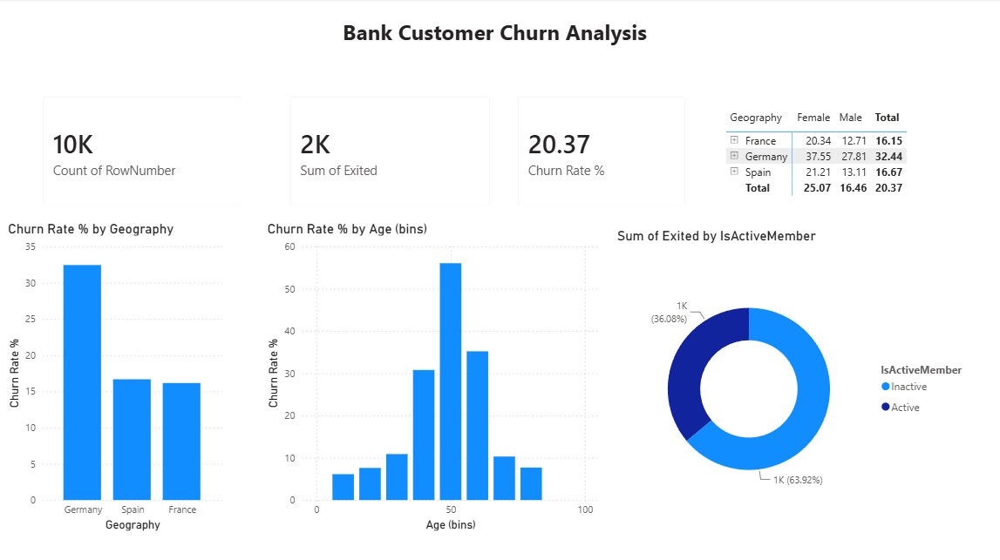

# LinkedIn Job Market Analytics

## Objective
Find which skills, roles, locations and salaries matter most in the data analytics job market in India.

## Dataset
A synthetic (practice) dataset of 6,293 job postings from Jan 2025 to Jul 2026.

## Tools Used
SQL Server (SSMS), Python (Pandas, Kaggle Notebooks), Power BI (DAX)

## Approach
1. SQL: wrote queries on roles, skills, locations and salary ranges.
2. Python: cleaned the data, split the skills column and explored it with EDA.
3. Power BI: built a dashboard to compare roles, skills and locations.

## Key Findings
- SQL is the most asked-for skill: in 76% of postings, then Excel (48%), Power BI (37%) and Python (33%)
- Entry-level roles are the largest group: 2,386 of 6,293 postings
- Average salary rises with level: about 6.3 LPA (Entry), 12.3 (Mid), 22.3 (Senior), 35.7 (Lead)
- Top hiring cities: Hyderabad (823 postings) and Bengaluru (770)
- Work type: 44% Onsite, 37% Hybrid, 19% Remote

## Dashboard

## Recommendations
- Learn SQL first, followed by Excel and Power BI.
- Freshers should target Hyderabad and Bengaluru for the most openings.

## Files
- `analysis_queries.sql`: SQL queries (SSMS)
- `linkedinjobpostings.ipynb`: Python EDA notebook
- `LinkedIn_Job_ Market_Dashboard.pbix`: Power BI dashboard
- `linkedin job postings.csv`: dataset
